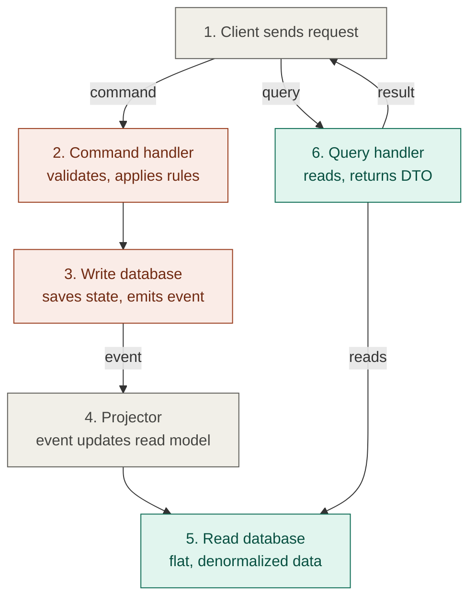
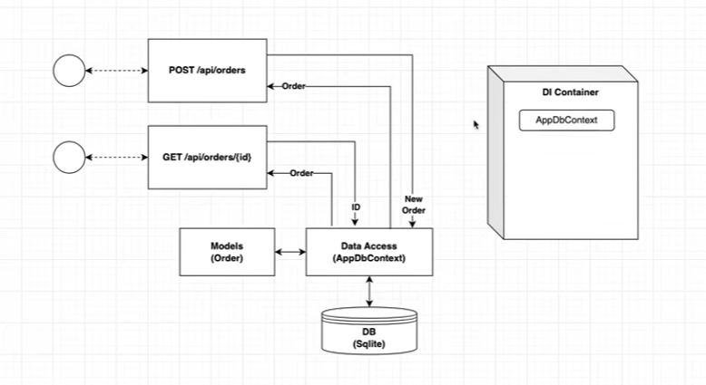
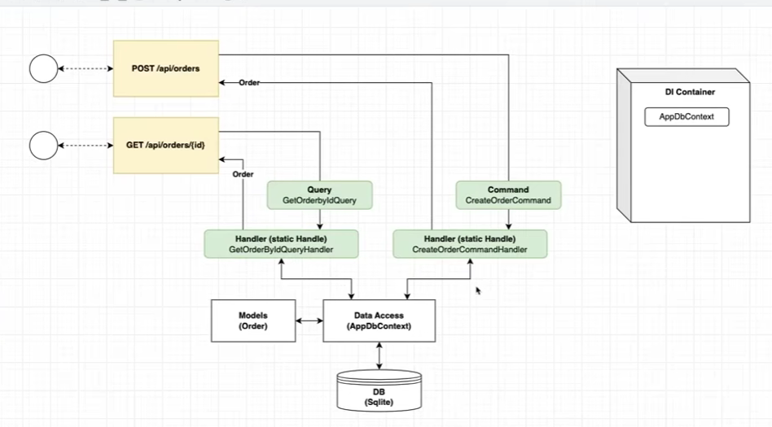
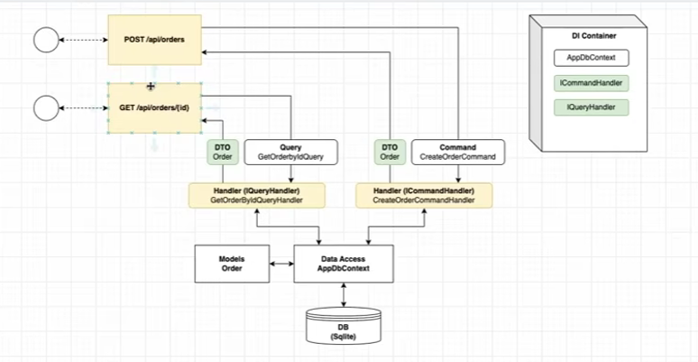
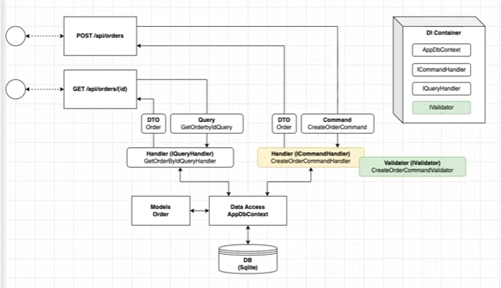
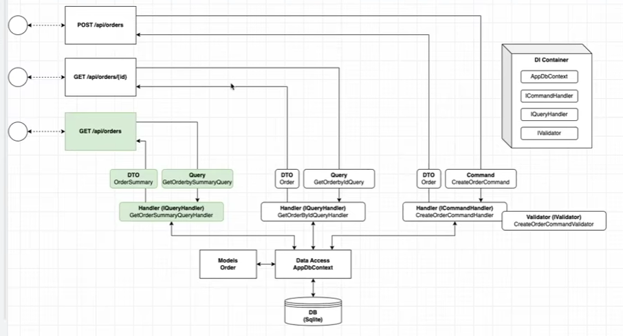
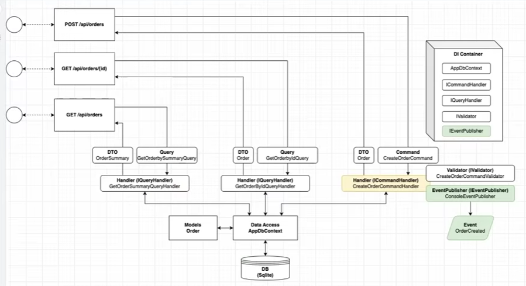
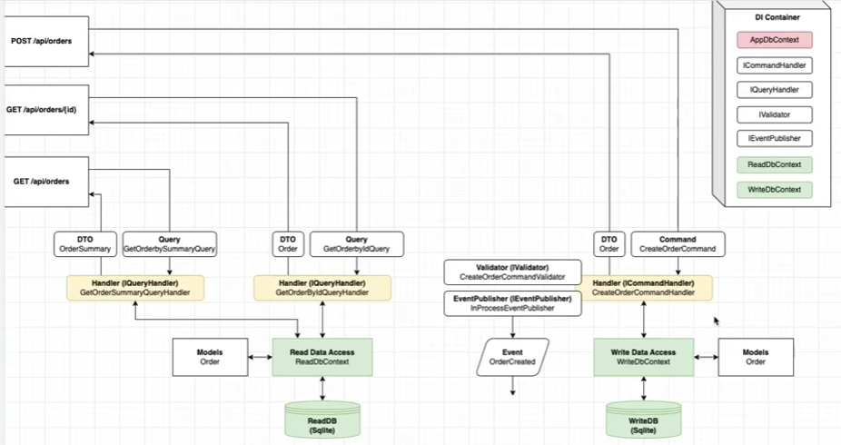
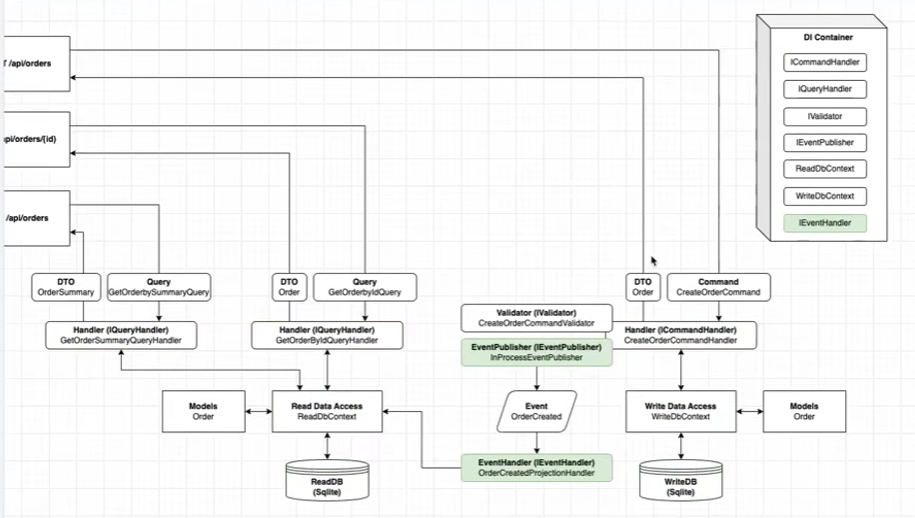
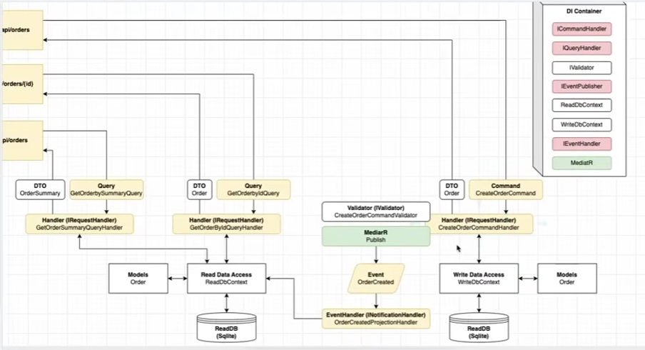

# CQRS (Command Query Responsibility Segregation)

A short guide to the CQRS architecture pattern: what it is, how it works step by step, and when to use it.

## Table of contents

1. [What is it?](#what-is-it)
2. [What happens in each step](#what-happens-in-each-step)
3. [When to use](#when-to-use)

---

## What is it?

CQRS means using **one model to change data** and **a different model to read data**.

In a typical app, one model and one database handle both jobs. The same `Order` class and the same tables serve "create an order" and "show me my order list". This works at first, but the two jobs want very different things:

|                  | Write side                             | Read side                                                |
| ---------------- | -------------------------------------- | -------------------------------------------------------- |
| Goal             | Protect business rules and correctness | Return data fast, in the shape a screen needs            |
| Data shape       | Normalized, small aggregates           | Flat, denormalized, pre-joined                           |
| Typical question | "Can this order be cancelled?"         | "Show the 20 latest orders with customer name and total" |

Forcing one model to do both makes it bloated and compromised. CQRS says these are two different problems, so give each its own model.

In short, you need to remember these items:

- Command Queries Responsibility Segregation
- Born out of the Domain Driven Design (DDD) movement
- Split the models for reading and writing
  - Commands modify data (Writing)
  - Queries retrive data (Reading)
- Ultimately about optimizing complex systems

### The two parts

- **Command**: a request to change state, such as `CreateOrder` or `CancelOrder`. It can be rejected if a business rule is broken. It returns success or failure (or an ID), not detailed data.
- **Query**: a request to read data, such as `GetOrderList`. It never changes state.

The idea comes from CQS (Bertrand Meyer): a method should either change state or return data, not both. Greg Young extended it to the architecture level.

### Levels of adoption

CQRS is not all-or-nothing. You can apply it gradually:

| Level                  | Description                                                                             |
| ---------------------- | --------------------------------------------------------------------------------------- |
| 1. Separate code       | Same database; only split command and query handlers (for example with MediatR in .NET) |
| 2. Separate read model | Same database; queries use views or dedicated read tables                               |
| 3. Separate databases  | A write database and a read database, kept in sync with events                          |
| 4. With Event Sourcing | The write side stores a sequence of events instead of current state                     |

CQRS and Event Sourcing are independent. You can use CQRS without Event Sourcing, and most projects should start that way.

### Analogy

A restaurant kitchen takes orders and cooks, where rules and order matter (write side). The menu board on the wall is a simplified copy made for quick reading (read side). When the kitchen changes a dish, someone updates the board a moment later. That small delay is **eventual consistency**.

---

## What happens in each step

### Workflow chart



Colors: orange = write side, green = read side, gray = shared or in between.

Text version of the same flow:

```
                 ┌─► 2. Command handler ─► 3. Write DB
1. Client ───────┤                              │ (event)
                 │                              ▼
                 │                        4. Projector
                 │                              │
                 └─► 6. Query handler ◄── 5. Read DB
```

### Step by step

**1. Client sends request**
The client sends either a command (change something) or a query (read something). The API routes commands to the write side and queries to the read side.

**2. Command handler**
Receives the command, validates it, loads the domain object (aggregate) and applies business rules. If a rule is broken, the command is rejected here. It usually returns only success/failure or an ID.

**3. Write database**
The change is saved in a database designed for correctness (normalized, transactional). After saving, the system emits an event such as `OrderCreated`. To avoid losing events, the event is usually stored in an "outbox" table in the same transaction.

**4. Projector**
A background consumer listens to those events and updates the read model. Because this happens after the write, the two sides can be out of sync for a short time (eventual consistency).

**5. Read database**
Holds data already shaped for screens: flat, pre-joined, denormalized. It can be a SQL view, Redis, Elasticsearch or any store that suits reading. It is derived data and can be rebuilt from events at any time.

**6. Query handler**
Runs a simple read against the read database and returns a ready-made DTO. No business logic and no domain model are involved, and it never changes data.

\*\*Core Concept:

- Command: Actions that modify the systems state
  --> Think: "do this"
- Queries: Requests to retrive data from the systems
  --> Does not modify state - think: "tell me something"
- Write Model: Responsible for handling commands and updating the datastore
- Read Model: Responsible for handling queries and retrivi data

### Minimal example (C# + MediatR)

```csharp
// Command
public record CreateOrderCommand(Guid CustomerId, List<OrderItem> Items) : IRequest<Guid>;

public class CreateOrderHandler : IRequestHandler<CreateOrderCommand, Guid>
{
    public async Task<Guid> Handle(CreateOrderCommand cmd, CancellationToken ct)
    {
        var order = Order.Create(cmd.CustomerId, cmd.Items); // business rules live in the domain
        _repo.Add(order);
        await _uow.SaveChangesAsync(ct);
        return order.Id;
    }
}

// Query
public record GetOrderSummaryQuery(Guid OrderId) : IRequest<OrderSummaryDto>;

public class GetOrderSummaryHandler : IRequestHandler<GetOrderSummaryQuery, OrderSummaryDto>
{
    public Task<OrderSummaryDto> Handle(GetOrderSummaryQuery q, CancellationToken ct)
        => _db.QuerySingleAsync<OrderSummaryDto>(
            "SELECT Id, CustomerName, Total, Status FROM vw_OrderSummary WHERE Id = @Id",
            new { Id = q.OrderId }); // read directly, no domain model
}
```

### Things to get right

- **Dual-write problem**: saving to the database and publishing an event are two separate operations, so an event can be lost. Use the Transactional Outbox pattern.
- **Idempotent consumers**: events may be delivered more than once, so the projector must handle duplicates safely.
- **Read-your-writes**: a user may not see their own change immediately. Handle it with optimistic UI, version checks, or reading from the write side for special cases.

---

## When to use

### Good fit

- Reads and writes have very different load, and you need to scale them separately.
- The domain is complex, with many business rules on the write side.
- You need many different views of the same data (dashboards, reports, search).
- Read performance is critical and needs heavy caching or denormalization.
- Several teams work on the same system (for example a business team and a reporting team).
- You need a full audit trail or change history (often combined with Event Sourcing).
- The system is already event-driven or based on microservices.
- There are significant differences in read and write workloads
- The system needs to be scale to handle high traffic
- Complex business rules should be abstracted
- When you've used it before successfully

### Not a good fit

- Most of the time
- Simple CRUD applications with few business rules.
- Small teams without experience in messaging and eventual consistency.
- Cases that need strong consistency everywhere (a read must see the write instantly).
- Prototypes and MVPs that need to ship fast.
- Low-traffic systems where one database is enough.

### Cost to expect

More code (commands, handlers, DTOs for each operation), harder debugging of asynchronous flows, handling duplicated or out-of-order events, and extra infrastructure to run and monitor.

### Typical use cases

| Domain               | How CQRS is used                                                                                  |
| -------------------- | ------------------------------------------------------------------------------------------------- |
| E-commerce           | Orders and stock in SQL; product catalog and search from Elasticsearch or Redis                   |
| Banking / finance    | Transactions stored as immutable events; balances and statements built as read models             |
| Booking / ticketing  | Huge volume of availability queries, strict handling of reservations to prevent double booking    |
| Real-time dashboards | Incoming data feeds read models that pre-aggregate the metrics                                    |
| Social feed          | Simple writes for posts, pre-computed feeds per user for reads                                    |
| IoT / monitoring     | High-volume metric writes into a write-optimized store, charts served from a read-optimized store |

### Benifit:

- Scalability: Commands and Queries can be scaled independently, allowing for efficient handling of workloads
- Maintainability: Separating the concerns makes the code more modular and easier to understand (maybe!)
- Flexibility: Different data stores and technologies can be used for reads and writes (not technically CQRS)
- Perfomance: Focused concerns often leads to optimization for both reads and writes

### Build stages: In this source code

- Build simple Minimal API (no CQRS)
- "Self-rolled" CQRS
- Evolving CQRS
- Adding validation (FluentValidation)
- Embedding the pattern - another handler
- Emmitting events
- Splitting the data, projection & eventual consistency
- Move to MediatR

### No CQRS



### Simple CQRS



### Evolving



### Validation



### More Endpoint



### Emit Event



### Split DBs





### Apply MediatR


